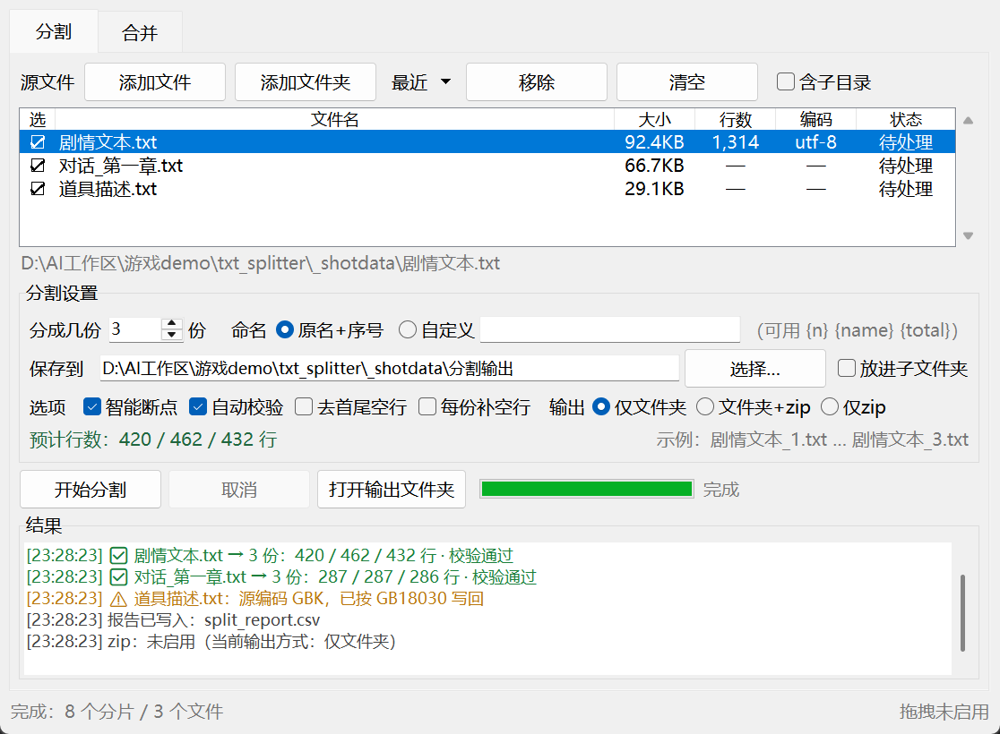

# TXT 分割 / 合并工具 v2.0

一个本地小工具：把 txt 按行平均分割成 N 份，或者把多份 txt 合并成一个。
仅使用 Python 标准库，界面为 tkinter，可打包成免安装 exe。



> 仓库根目录已附带打包好的 `TXT分割工具.exe`（约 14 MB），打开文件页点右上角 **Download** 即可，不用装 Python。

## 直接运行

**已打包好免安装版：双击 `TXT分割工具.exe` 即可**（不需要装 Python，约 14 MB）。

- 首次启动如果 Windows 弹「已保护你的电脑」，点「更多信息 → 仍要运行」。
- 个别杀毒软件会拦截 PyInstaller 单文件程序；遇到时改用源码方式运行（见下），或用 `build_exe.bat` 重新打包。

也可以用源码运行，需要 Python 3.9+（安装时勾选 tcl/tk，官方安装包默认带）：

- 双击 `启动工具.bat`（无控制台窗口）
- 或命令行：`python txt_splitter.py`

拖拽文件是**可选**功能，装了就自动启用：

```bat
pip install tkinterdnd2
```

没装也能正常用，只是拖不进文件，改用「添加文件 / 添加文件夹」即可。

## 功能一览

| 功能 | 说明 |
|---|---|
| 按行平均分割 | 填份数即可，余数分给最前面的几份（100 行分 3 份 = 34/33/33） |
| 智能断点 | 切点优先落在「第 X 章」标题、分隔线、空行处，不把段落劈成两半 |
| 两种命名 | 原名+序号（`小说_01.txt`）；自定义基础名（`第一章_01.txt`，支持 `{n}` `{name}` `{total}`） |
| 保存位置自选 | 默认源文件目录，可选放进 `<原名>_split` 子文件夹 |
| 批量分割 | 一次处理多个文件 / 整个文件夹（可选含子目录） |
| 自动校验 | 写完读回逐份比对 + 整体 SHA256，失败红色报警并定位到第几份第几行 |
| 空行整理 | 每份去首尾空行 / 每份末尾补空行，可同时开 |
| zip 导出 | 仅文件夹 / 文件夹+zip / 仅 zip，zip 里附带 `split_report.csv` |
| 多文件合并 | 可调顺序，文件间补空行或插来源标记，统一换行符与编码 |
| 分片还原 | 合并页「按分片序号还原」，把 `_01.._NN` 按顺序拼回原文件 |
| 记住设置 | 上次目录、份数、命名方式、勾选项、窗口大小位置 |
| 拖拽 | 可选依赖 `tkinterdnd2`，未安装自动降级 |

## 分割页使用步骤

1. **添加文件**：点按钮选择，或把 txt / 文件夹拖进列表；勾选「含子目录」可连子文件夹一起扫。
2. **分成几份**：填数字。份数大于行数时会自动降为行数并提示。
3. **命名方式**：
   - 原名+序号：`剧情文本.txt` → `剧情文本_1.txt`、`剧情文本_2.txt`…
   - 自定义：填基础名，如 `第一章` → `第一章_1.txt`；也可写 `第{n}章` → `第1章.txt`
   - 序号补零宽度按份数自动算：9 份是 `_1…_9`，12 份是 `_01…_12`，保证按文件名排序就是正确顺序
4. **保存到**：选目录；勾「放进子文件夹」会输出到 `<原名>_split`。
5. **选项**：智能断点 / 自动校验默认开；空行整理默认关。
6. **开始分割**：结果面板会逐行显示每份行数和校验状态，绿色=通过，红色=失败。

列表里「行数 / 编码」在点选该行时统计（大文件不卡界面）。预览区会显示切分后的预计行数和文件名示例。

## 智能断点是怎么切的

目标切点按行数均分算出，然后在目标附近（份长的 10%，最多 200 行）找候选：

| 优先级 | 候选位置 | 权重 |
|---|---|---|
| 高 | `第X章/节/卷/回/篇/部/集/幕/话`、Markdown `#` 标题、`Chapter 1` | 100 |
| 中 | 分隔线 `===`、`---`、`***` | 60 |
| 低 | 空行之后（上一份以空行收尾） | 20 |

得分 = 权重 − 离目标的行数，取最高分。所以「章节标题」哪怕偏几十行，也优于紧贴目标但会劈开段落的空行。

- 关掉智能断点 = 严格均分，任意两份最多差 1 行。
- 开着时行数可能略微不均（换来段落完整），预览区会先显示预计分布。

## 自动校验

写完立刻把分片从磁盘读回来比对，不是只信内存：

- **严格模式**（空行整理都关）：每份内容 == 源文件对应行，且整体拼接 SHA256 与原文件一致、行数一致。
- **宽松模式**（开了去空行/补空行）：先按同样规则规范化再比对，并报告「删空行 X 行 / 补空行 Y 行」，明确这是排版调整而非丢字。

校验失败会在结果面板红字提示，例如：
`❌ 校验失败：第 3/12 份内容不一致（起始于该份第 120 行）`

## zip 导出的三种方式

| 方式 | 结果 |
|---|---|
| 仅文件夹 | 输出目录里是散装 txt + `split_report.csv` |
| 文件夹+zip | 散装 txt 之外再生成 `<原名>_split.zip`，方便一次发走 |
| 仅 zip | 分片先写到输出目录内的隐藏临时夹，打包后只留 zip + 报告 |

- 单文件：`<原名>_split.zip`
- 批量：一个总包 `批量分割_时间戳.zip`，内部按 `<原名>_split/` 分子目录
- zip 内默认附带 `split_report.csv`（含每份起止行、行数、字符数、SHA256 前 16 位）
- zip 只打包本次生成的分片，不会把输出目录里的其他文件卷进去

## 合并页

1. 添加多个 txt（可拖入），用「上移 / 下移」或排序按钮调整顺序。
2. 选项：
   - 文件之间：不补 / 补一个空行 / 插入 `--- 来源: 文件名 ---`
   - 换行符：保持原样 / 统一 CRLF / 统一 LF
   - 输出编码：UTF-8 / UTF-8 BOM / GB18030
   - 去每份首尾空行、合并后校验
3. 填输出文件名和目录，开始合并。同名文件不会被覆盖，会自动加 `(1)`。

「按分片序号还原」会按文件名里的数字排序，适合把之前切出来的 `_01.._NN` 拼回去。

## 配置文件

优先保存在工具同目录 `config.json`（便携，拷走工具连设置一起带走）；目录不可写时退回
`%APPDATA%\TxtSplitter\config.json`。删掉该文件即恢复默认设置。

## 打包成 exe

仓库里已经放了打包好的 `TXT分割工具.exe`；要重新打包时，双击 `build_exe.bat`，或手动执行：

```bat
pip install pyinstaller
python -m PyInstaller --noconfirm --clean --onefile --noconsole ^
  --name "TXT分割工具" ^
  --hidden-import tkinterdnd2 --collect-data tkinterdnd2 ^
  txt_splitter.py
```

产物在 `dist\TXT分割工具.exe`。

注意：

- 没装 `tkinterdnd2` 时不要加那两个参数，否则打包会报找不到包。`build_exe.bat` 已自动判断。
- PyInstaller 对最新 Python 版本的支持可能滞后。若打包报错，用 Python 3.11–3.13 建虚拟环境再打。
- 打包后拖拽失效，通常是漏了 `--hidden-import tkinterdnd2 --collect-data tkinterdnd2`。

## 已知限制

- **编码**：自动识别 UTF-8(BOM) / UTF-8 / GB18030(GBK) / UTF-16(BOM)。无 BOM 的 UTF-16 纯中文文件可能识别成 GBK，遇到乱码请先用记事本另存为 UTF-8。
- **大文件**：超过 200MB 会弹窗确认，切分时整份读入内存。几百 MB 的文本建议直接用命令行工具流式处理。
- **超长单行**：按行切分，如果整个文件只有一行（比如压缩成一行的 JSON），只会得到 1 份。
- **zip 中文名**：Windows 10 及以上资源管理器解压正常；很老的解压软件可能显示乱码。
- **分片还原排序**：优先取文件名末尾的数字，没有数字的文件排在最后。

## 自测

```bat
python selftest.py
python gui_smoke.py
```

- `selftest.py`：53 项核心用例（均分、智能断点、编码、CRLF、空行、篡改检测、批量失败、zip、合并还原、配置、命名、随机切点性质）
- `gui_smoke.py`：17 项界面用例（真实建窗、加文件、跑分割/合并、进度、日志、配置采集）

## 文件说明

| 文件 | 用途 |
|---|---|
| `TXT分割工具.exe` | **免安装可执行文件，双击运行**（Python 3.12 + PyInstaller 6.22.3 打包，含拖拽） |
| `txt_splitter.py` | 主程序源码（核心 + 界面，单文件） |
| `启动工具.bat` | 双击启动（优先 pythonw，无黑框） |
| `build_exe.bat` | 一键打包 exe |
| `selftest.py` / `gui_smoke.py` | 自测脚本 |
| `screenshot_split.png` / `screenshot_merge.png` | 界面截图 |

## 许可

MIT，见 [LICENSE](LICENSE)。
